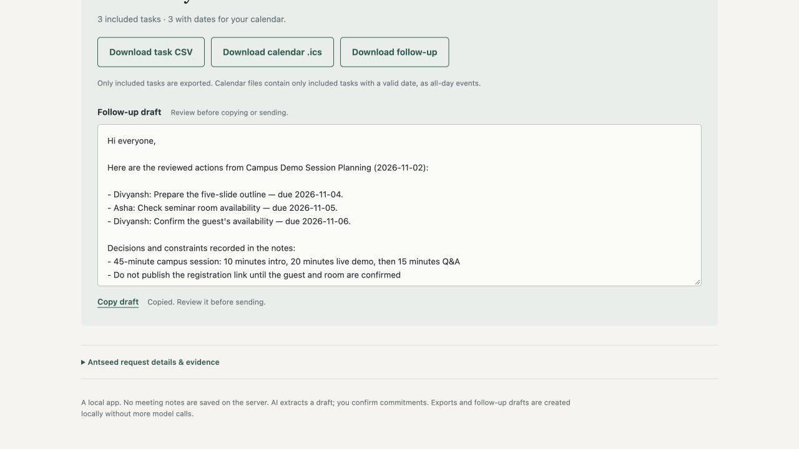

# Meeting Actions — built on Antseed

Turn rough meeting notes into a handoff you can actually use: **reviewed tasks, calendar dates and a follow-up draft**.

Paste notes or import a `.txt`/`.md` file. Antseed supplies the model call; the app extracts tasks, decisions and unresolved questions. Each item links to an exact quote from the notes. You edit owners and dates, then choose which tasks to include in the exports.

## 42-second walkthrough

https://github.com/user-attachments/assets/d05bec33-c9b7-47e0-9bab-9422f082a950

[Download the MP4](media/meeting-actions-demo.mp4) · [Transcript](media/transcript.txt)



## Try the sample

1. Click **Load sample meeting**, then **Make an action plan**.
2. Inspect the source quote for a task. Notice the missing guest-confirmation owner and vague rehearsal date.
3. Assign an owner and date where you have agreed them. Tick **Include**, or confirm the tasks that already have an owner and date.
4. Download the task CSV, calendar file or follow-up draft. The app makes those exports locally without another model call.

The recorded sample produced five tasks, two decisions/constraints and two open questions through a live Antseed gateway call. Three tasks were then reviewed and exported. See the actual [CSV](evidence/confirmed-tasks.csv), [calendar file](evidence/confirmed-tasks.ics) and [follow-up draft](evidence/follow-up.txt).

**View recorded Antseed run** loads the saved output without a live connection. A visible banner identifies it as recorded. Use the [demo script](DEMO_SCRIPT.md) to explain the app and its limits.

## Run locally

Requires Python 3.10+. The app itself has no third-party runtime dependencies. Install Antseed using the [official guide](https://antseed.com/docs/install/).

For a buyer on its default port, run `antseed buyer start` in one terminal, then:

```sh
python3 server.py
```

Open <http://127.0.0.1:18400>. The default Antseed URL is `http://127.0.0.1:8377`.

To use an existing gateway and your own key:

```sh
ANTSEED_BASE_URL=http://127.0.0.1:8379 \
ANTSEED_API_KEY='your-key' \
python3 server.py
```

You can also provide `ANTSEED_KEY_FILE` pointing to a local JSON file with an `apiKey` field. Keep it outside tracked files. The test used `@antseed/cli@0.1.222`, an isolated unfunded identity, and a localhost gateway. No wallet was funded and no paid offer was selected.

For an offline demonstration, start only `python3 server.py` and click **View recorded Antseed run**. Set `MEETING_ACTIONS_PORT` to change the app's port.

## What makes the workflow useful

- Owners and dates are editable fields, rather than details buried in a summary.
- Missing owners and vague deadlines stay visible. The app does not calculate dates from phrases such as “before rehearsal.”
- Source quotes let you check the model's interpretation.
- Unassigned tasks cannot be included until you assign an owner. All tasks start unconfirmed.
- The CSV and follow-up contain only included, assigned tasks. The calendar contains only included tasks with valid dates, as all-day events.
- Decisions, constraints and open questions stay alongside the action list.

The owner and date assigned to the guest-confirmation task in the example exports were **human demo edits**, not information invented by the model. Original extraction and reviewed state are both retained in the example JSON.

## How Antseed is used

The server discovers current zero-priced chat offers with reputation at least 60 and no staking requirement. It prefers familiar service IDs, pins the chosen peer, requests JSON through Chat Completions, and checks the response peer. Automatic selection may try one alternate eligible free offer. The UI keeps connection details out of the main meeting workflow but exposes the selected model, peer, time and request evidence.

Catalog availability, quotes and free quotas can change. A gateway spending allowance is separate from wallet balance, and temporary holds may block a very small allowance before actual spend. The app explains that error without changing any limits. See Antseed's [budget documentation](https://antseed.com/docs/gateway/budgets/).

## Validation and limits

```sh
python3 -m unittest -v
node --test web/exports.test.js
```

The tests cover source matching, unsupported owners/dates, vague and invalid dates, bounded retry, spending-limit handling, reviewed-only exports, CSV escaping and calendar formatting. Node is needed only for the export tests.

A live sample run through the gateway returned HTTP 200 in 13.76 seconds, matched the selected peer and had $0.00 recorded gateway spend. Browser tests exercised review, owner/date edits and all three downloads. This is one successful sample, not an accuracy or reliability benchmark. See [EVIDENCE.md](EVIDENCE.md).

Source matching verifies that quoted words exist in the notes; it does not prove the extracted task is correct. Review the agreement before including it. Notes are sent to an independent provider and are not saved by the app's server. The app does not transcribe audio, send messages, connect to a task service or add events to your calendar automatically.

## Developer-experience contribution

This is a reference application for a practical newcomer workflow: connect to Antseed, reach a useful result, recover from provider errors and inspect the evidence. It gives a concrete starting point for testing onboarding with other developers and improving starter examples and documentation.

The earlier [Antseed field study](https://github.com/divyanshAgarwal123/antseed-issue-workbench) contains the original API probes and spend-cap observations. Those records predate this app. The budget hold is documented behavior encountered during testing, with a UX question; it is not presented as a new billing vulnerability.
